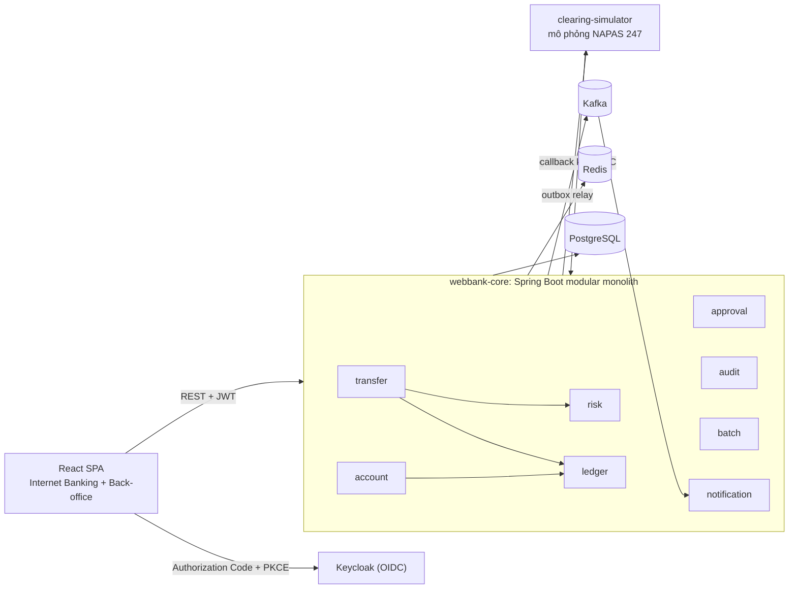

# WebBank: kế hoạch kỹ thuật và lựa chọn công nghệ

Mục tiêu là một dự án đủ nhỏ để một người làm xong, nhưng mỗi tính năng đều giải một bài toán thật
của ngân hàng và **có bằng chứng** đi kèm (test, demo, số liệu). Dự án không cố gắng có nhiều màn
hình CRUD.

**Giả định khi lập kế hoạch** (sửa lại nếu khác thực tế):

- Vị trí ứng tuyển: Java Backend (junior đến mid) ở ngân hàng hoặc fintech Việt Nam.
- Một người làm, khoảng 3–4 giờ mỗi ngày, nên toàn bộ lộ trình mất khoảng 6–8 tuần. Có lộ trình rút
  gọn 2 tuần ở [mục 6](#6-lộ-trình).
- Frontend chỉ là nơi để demo. Điểm được chấm nằm ở backend.

## 1. Người phỏng vấn ở ngân hàng thực sự chấm gì?

| Tiêu chí | Câu họ tự hỏi | Dự án trả lời bằng |
| --- | --- | --- |
| Tiền luôn đúng | "Hai request đồng thời có làm âm số dư không? Client retry có trừ tiền hai lần không?" | Sổ cái kép, khóa có thứ tự, idempotency (A1–A3) |
| Chịu lỗi khi tích hợp | "Hệ thống đối tác timeout thì tiền của khách đang ở đâu?" | Outbox, saga, trạng thái UNKNOWN, đối soát (A4, A5, B3) |
| Bảo mật và tuân thủ | "Khách A có xem được tài khoản của khách B không? Ai đã làm gì, lúc nào?" | OIDC, chống BOLA, OTP gắn với giao dịch, audit chống sửa (A6) |
| Vận hành | "Cuối ngày hệ thống chạy những gì? Có sự cố thì truy vết ra sao?" | Spring Batch EOD, tracing, dashboard (B3, B4) |
| Chất lượng kỹ thuật | "Làm sao chứng minh code này đúng?" | Testcontainers, test đồng thời, load test có số liệu |

## 2. Kiến trúc: modular monolith và một hệ thống ngoài mô phỏng



**Vì sao không làm microservices cho mọi thứ?** Chuyển tiền nội bộ phải cập nhật tài khoản và sổ cái
trong **một** transaction ACID. Nếu tách account và ledger thành hai service, ta buộc phải dùng saga
cho một việc mà transaction của database làm đúng ngay từ đầu, và kết quả là một "distributed
monolith". Dự án chỉ phân tán ở những chỗ nghiệp vụ vốn đã phân tán: chuyển tiền liên ngân hàng (đi
qua hệ thống ngoài) và thông báo (bất đồng bộ qua Kafka). Ranh giới giữa các module được Spring
Modulith kiểm tra tự động, nên sau này tách một module thành service riêng chỉ còn là việc cơ học. Đây
cũng là câu trả lời cho câu hỏi kinh điển "Tại sao không dùng microservices?".

| Module | Trách nhiệm |
| --- | --- |
| `customer` | Hồ sơ khách hàng (CIF), liên kết với user trên Keycloak |
| `account` | Tài khoản thanh toán và tiết kiệm, trạng thái (ACTIVE, FROZEN, CLOSED) |
| `ledger` | Sổ cái kép: bút toán, số dư, phong tỏa (hold), bút toán đảo |
| `transfer` | Chuyển tiền nội bộ và liên ngân hàng, idempotency, saga |
| `risk` | Hạn mức, quy tắc chống gian lận (velocity) |
| `security` | OTP, xác thực bổ sung (step-up), rate limit |
| `approval` | Maker-checker cho nghiệp vụ back-office |
| `audit` | Nhật ký kiểm toán chỉ ghi thêm, có hash chain |
| `notification` | Nhận sự kiện từ Kafka, gửi SMS/email/push (mô phỏng) |
| `batch` | Xử lý cuối ngày: tính lãi, đối soát, sao kê |

## 3. Công nghệ và lý do chọn

Bảng dưới chỉ tóm tắt. Phân tích bản chất từng công nghệ, so sánh với các phương án thay thế (ví dụ
Kafka so với RabbitMQ, ActiveMQ, IBM MQ, Pulsar) và câu hỏi phỏng vấn kèm ý trả lời nằm trong
[docs/tech/](tech/README.md).

### Backend

| Công nghệ | Dùng để | Vì sao (nhìn từ góc độ ngân hàng) |
| --- | --- | --- |
| Java 21 LTS | Ngôn ngữ | Bản LTS mà các ngân hàng đang chuẩn hóa: record, sealed interface, pattern matching, virtual threads |
| Spring Boot 4.1 (Spring Framework 7, Security 7, Jackson 3) | Nền tảng | Bản ổn định mới nhất. Nên nắm thêm khác biệt Boot 2 → 3 → 4 (javax → jakarta, starter được tách module) vì nhiều ngân hàng vẫn đang chạy 2.7 hoặc 3.x |
| PostgreSQL 17 | Cơ sở dữ liệu chính | ACID, khóa dòng, `SKIP LOCKED`, CHECK constraint, partitioning. Kiến thức này áp dụng gần như nguyên vẹn sang Oracle, hệ quản trị phổ biến ở core banking |
| Flyway | Migration | Schema có version và review được. Không bao giờ dùng `ddl-auto=update` |
| Spring Data JPA (Hibernate 7) + `JdbcClient` | Truy cập dữ liệu | JPA cho aggregate, SQL thuần cho đường nóng và báo cáo: thể hiện mình biết khi nào **không** nên dùng ORM |
| Spring Modulith | Kiến trúc | Ép ranh giới module, có test `verify()`, sinh tài liệu C4 |
| Apache Kafka 4 (KRaft) + Spring Kafka | Sự kiện tích hợp | Gần như là chuẩn ở các ngân hàng Việt Nam. Có retry topic, dead letter topic, giữ thứ tự theo key |
| Redis 8 | Rate limit, bộ đếm velocity, cache dữ liệu tham chiếu | Thao tác nguyên tử (INCR, Lua) có TTL. **Không** cache số dư |
| Keycloak 26 | Identity provider (OIDC) | Không tự viết đăng nhập hay tự lưu mật khẩu. Đúng chuẩn OAuth2/OIDC, có sẵn MFA |
| Resilience4j 2.4 (`resilience4j-spring-boot4`) | Timeout, retry, circuit breaker, bulkhead | Gọi hệ thống ngoài một cách an toàn. Spring Framework 7 đã có sẵn `@Retryable`, nhưng vẫn cần Resilience4j cho circuit breaker |
| Spring Batch 6 + ShedLock | Xử lý cuối ngày, job định kỳ | Xử lý theo chunk, chạy lại từ điểm lỗi, không chạy trùng khi có nhiều instance |
| Micrometer + OpenTelemetry | Metrics, tracing, log có cấu trúc | Truy vết một giao dịch qua API → Kafka → hệ thống ngoài |
| springdoc-openapi 3.2 | Tài liệu API | Swagger UI để demo |
| Testcontainers, JUnit 6, AssertJ, Awaitility, WireMock, ArchUnit | Kiểm thử | Test trên PostgreSQL và Kafka thật. H2 không mô phỏng đúng cơ chế khóa |
| k6 | Load test | Có số liệu TPS và p99 để nói chuyện bằng con số |

### Frontend

| Công nghệ | Dùng để |
| --- | --- |
| React 19 + TypeScript + Vite 8 | SPA |
| Ant Design 6 | Bảng, form, steps, modal: bộ component quen thuộc trong các hệ thống doanh nghiệp và ngân hàng ở Việt Nam |
| TanStack Query 5 | Quản lý server state. Cố ý **không** tự retry các thao tác ghi |
| React Router 8 | Điều hướng, chặn route theo role |
| oidc-client-ts + react-oidc-context | Đăng nhập qua Keycloak bằng Authorization Code + PKCE |

### Hạ tầng

Docker Compose cho môi trường local, GitHub Actions cho CI, image `grafana/otel-lgtm` (gói Grafana,
Tempo, Loki và Prometheus trong một container) để quan sát hệ thống khi dev. Kubernetes manifest là
tùy chọn.

## 4. Các điểm nhấn: trọng tâm của dự án

Mỗi mục đi theo bốn phần: **vấn đề** (làm ngây thơ thì hỏng thế nào), **giải pháp**, **bằng
chứng**, và **câu hỏi phỏng vấn** mà mục đó giúp trả lời.

### Nhóm A: bắt buộc. Câu chuyện chính là "tiền luôn đúng"

#### A1. Sổ cái kép (double-entry ledger) và kiểu `Money`

- **Vấn đề:** `UPDATE account SET balance = balance - x` làm mất lịch sử, không đối soát được, và khi
  có sai lệch thì không biết sai ở đâu. Kiểu `double` gây sai số làm tròn.
- **Giải pháp:**
  - Mọi biến động tiền là một `journal_entry` gồm ít nhất hai `posting` (Nợ/Có) có tổng bằng 0.
    Posting **chỉ được ghi thêm**: sửa sai bằng bút toán đảo (reversal), không bao giờ
    `UPDATE` hay `DELETE`.
  - Số dư được cập nhật trong cùng transaction với posting để đọc nhanh. Phân biệt **số dư sổ sách**
    (ledger balance) với **số dư khả dụng** (available balance = ledger balance trừ các khoản đang
    phong tỏa).
  - Có các tài khoản nội bộ (GL): tài khoản trung gian thanh toán liên ngân hàng, thu phí, chi trả
    lãi. Phí chuyển tiền là một posting riêng.
  - `Money` là value object (`BigDecimal` kèm `Currency`), scale theo ISO 4217 (VND = 0, USD = 2),
    luôn chỉ rõ `RoundingMode`. Trong DB dùng `NUMERIC(19,4)`. JSON trả số tiền dạng chuỗi để
    JavaScript không làm tròn.
- **Bằng chứng:** test bất biến chạy hàng nghìn giao dịch ngẫu nhiên rồi kiểm tra tổng mọi posting
  bằng 0 và số dư từng tài khoản bằng tổng posting của nó. Ở DB có ràng buộc
  `CHECK (available_balance >= 0)`.
- **Câu hỏi:** Vì sao không dùng `double`? `BigDecimal.equals` khác `compareTo` ở đâu (`1.0` so với
  `1.00`)? Giao dịch sai thì sửa thế nào? Số dư sổ sách khác số dư khả dụng ra sao?

#### A2. Xử lý đồng thời: không âm tiền, không deadlock

- **Vấn đề:** hai lệnh chuyển cùng đọc số dư 100 rồi cùng trừ 80, gây lost update và âm tiền. Lệnh
  A→B và B→A chạy cùng lúc thì gây deadlock.
- **Giải pháp:**
  - Khóa bi quan `SELECT … FOR UPDATE` (`@Lock(PESSIMISTIC_WRITE)`) trên cả hai tài khoản, **luôn
    khóa theo thứ tự id tăng dần** để không thể xảy ra deadlock. Đặt `lock_timeout` để không chờ vô
    hạn.
  - Optimistic locking (`@Version`) cho dữ liệu ít tranh chấp: hồ sơ khách hàng, cấu hình hạn mức,
    yêu cầu phê duyệt.
  - CHECK constraint ở DB là chốt chặn cuối cùng nếu code có bug.
  - Isolation level: READ COMMITTED cộng với khóa dòng tường minh. Giải thích được khi nào cần
    SERIALIZABLE, và khi đó phải retry lỗi `40001`.
- **Bằng chứng:** cho 100 luồng cùng chuyển 10 từ một tài khoản có 500: đúng 50 lệnh thành công, số
  dư cuối bằng 0 và không lúc nào âm. Chuyển chéo A↔B hàng trăm lần không gây deadlock. Điểm cộng:
  đo pessimistic so với optimistic khi tranh chấp cao và ghi kết quả vào `docs/`.
- **Câu hỏi:** Khi nào chọn optimistic, khi nào chọn pessimistic? Các mức isolation và các hiện
  tượng tương ứng (dirty read, non-repeatable read, phantom, lost update, write skew)? Deadlock là gì,
  phòng tránh thế nào? Các bẫy của `@Transactional` (gọi nội bộ trong cùng class, checked exception
  không rollback, `REQUIRES_NEW`)? Tài khoản "nóng" nhận hàng nghìn giao dịch mỗi giây thì xử lý ra
  sao?

#### A3. Idempotency: client retry không bao giờ trừ tiền hai lần

- **Vấn đề:** app mobile bị timeout rồi gửi lại request, khách bị chuyển tiền hai lần.
- **Giải pháp:** header `Idempotency-Key` là bắt buộc với mọi API ghi tiền; client sinh một UUID cho
  mỗi *ý định* chuyển tiền. Bảng `idempotency_key` có unique `(customer_id, key)`, lưu hash của
  request và response, và được ghi **trong cùng transaction** với giao dịch:
  - trùng key, cùng nội dung: trả lại đúng response cũ;
  - trùng key, khác nội dung: trả `422`;
  - hai request trùng key đến cùng lúc: request sau chờ trên unique index rồi nhận kết quả của
    request trước.

  Toàn bộ được đóng gói thành annotation `@Idempotent` dùng lại được, kèm một job dọn các key đã hết
  hạn (24 giờ).
- **Bằng chứng:** gửi cùng một request 20 lần song song, kết quả là đúng 1 giao dịch và 20 response
  giống hệt nhau.
- **Câu hỏi:** Làm một API POST trở nên idempotent thế nào? Lưu key ở DB hay Redis, vì sao? Server
  crash giữa chừng thì sao? Exactly-once khác at-least-once kết hợp idempotent thế nào?

#### A4. Transactional outbox và Kafka

- **Vấn đề (dual write):** commit DB xong mới gửi Kafka thì crash ở giữa sẽ làm mất sự kiện. Gửi
  Kafka trước rồi transaction rollback thì phát ra một sự kiện "ma".
- **Giải pháp:** ghi sự kiện vào bảng `outbox` trong cùng transaction nghiệp vụ. Một relay đọc bảng
  này bằng `FOR UPDATE SKIP LOCKED` (nhiều instance không tranh nhau) rồi đẩy lên Kafka với
  `acks=all` và idempotent producer; partition key là số tài khoản để giữ thứ tự. Consumer phải
  idempotent (bảng `processed_event`), dùng `@RetryableTopic` có backoff và dead letter topic. Cần
  nêu được phương án production thay thế: Debezium CDC đọc WAL.
- **Bằng chứng:** tắt Kafka thì giao dịch vẫn thành công và sự kiện nằm chờ trong outbox; bật lại thì
  sự kiện được gửi đủ. Gửi trùng message thì consumer chỉ xử lý một lần.
- **Câu hỏi:** Dual write là gì? Kafka giữ thứ tự thế nào? Exactly-once của Kafka có giải quyết được
  hết không? Xử lý message lỗi (poison pill) ra sao?

#### A5. Chuyển tiền liên ngân hàng: saga, trạng thái "chưa xác định" và đối soát

- **Vấn đề:** gọi sang hệ thống bù trừ (kiểu NAPAS 247) có thể lỗi, chậm, hoặc **đã thành công
  nhưng mất response**: tiền của khách đã bị trừ mà không biết kết quả. Không thể dùng 2PC với một
  ngân hàng khác.
- **Giải pháp:** saga dạng điều phối (orchestration), state machine được lưu trong DB:

  ```mermaid
  stateDiagram-v2
      [*] --> FUNDS_HELD: phong tỏa số tiền
      FUNDS_HELD --> SUBMITTED: gửi sang clearing
      SUBMITTED --> COMPLETED: thành công
      SUBMITTED --> FAILED: bị từ chối
      SUBMITTED --> UNKNOWN: timeout hoặc mất response
      UNKNOWN --> COMPLETED: tra soát thấy thành công
      UNKNOWN --> FAILED: tra soát thấy thất bại
      COMPLETED --> [*]: hạch toán, giải tỏa
      FAILED --> [*]: giải tỏa
  ```

  - **Nguyên tắc vàng:** gặp timeout thì **không hoàn tiền ngay** mà phải tra soát (status inquiry),
    vì tiền có thể đã đến tay người nhận.
  - Resilience4j: timeout; circuit breaker (khi clearing sập thì báo lỗi ngay thay vì để thread chờ
    dồn lại); bulkhead. Chỉ retry những thao tác an toàn: tra soát, hoặc gửi lại với cùng mã tham
    chiếu mà phía clearing tự loại trùng.
  - `clearing-simulator` là một ứng dụng Spring Boot riêng, cấu hình được độ trễ, tỉ lệ lỗi, tỉ lệ
    timeout và callback trùng. Callback được ký HMAC. Cuối ngày hệ thống này xuất file quyết toán để
    đối soát (xem B3).
- **Bằng chứng:** integration test cho từng nhánh: timeout → UNKNOWN → tra soát → COMPLETED; bị từ
  chối thì giải tỏa đúng số tiền; callback trùng thì bị bỏ qua.
- **Câu hỏi:** Saga hay 2PC? Orchestration hay choreography? Compensation khác rollback ở đâu?
  Circuit breaker có những trạng thái nào? Retry storm là gì, exponential backoff với jitter giải
  quyết nó ra sao?

#### A6. Bảo mật theo chuẩn ngân hàng

- **Xác thực:** Keycloak (OIDC). SPA dùng Authorization Code + PKCE và chỉ giữ token trong bộ nhớ.
  Backend là OAuth2 Resource Server, kiểm tra JWT (issuer, audience, thời hạn) và chuyển role của
  Keycloak thành authority của Spring.
- **Phân quyền:** các role `CUSTOMER`, `TELLER`, `SUPERVISOR`, `ADMIN`, cộng với kiểm tra **quyền sở
  hữu tài nguyên** để chống BOLA/IDOR (lỗi số 1 trong OWASP API Security Top 10): khách A gọi
  `/accounts/{id của B}` thì nhận `404`. Mỗi endpoint có test riêng cho trường hợp này.
- **Step-up và ký giao dịch:** giao dịch vượt ngưỡng phải nhập OTP (TOTP theo RFC 6238, hoặc SMS mô
  phỏng). OTP gắn với hash của (tài khoản nguồn, tài khoản đích, số tiền) nên không dùng lại được cho
  giao dịch khác. OTP được lưu dạng hash, hết hạn sau 3 phút, sai tối đa 5 lần. Ngưỡng có thể cấu hình
  theo tinh thần Quyết định 2345/QĐ-NHNN: giao dịch trên 10 triệu đồng một lần, hoặc tổng trên 20
  triệu đồng một ngày, phải xác thực mạnh. Thực tế ngân hàng dùng sinh trắc học; dự án mô phỏng bằng
  OTP.
- **Rate limit:** Bucket4j với Redis, theo user và theo IP; chặt hơn với OTP và đăng nhập.
- **Audit log:** chỉ ghi thêm, lưu ai làm gì, khi nào, từ đâu (IP, trace id). Mỗi dòng chứa hash của
  dòng trước (hash chain) để phát hiện sửa hoặc xóa. User DB của ứng dụng bị
  `REVOKE UPDATE, DELETE` trên bảng audit.
- **Dữ liệu cá nhân:** che số tài khoản và số điện thoại trong log. Cột nhạy cảm như số CCCD được mã
  hóa AES-GCM qua JPA `AttributeConverter`, khóa lấy từ biến môi trường.
- **Câu hỏi:** JWT hay session? Thu hồi JWT thế nào? Lưu token ở đâu trên trình duyệt? CSRF với SPA?
  Hash khác mã hóa ở đâu? TOTP hoạt động thế nào?

### Nhóm B: điểm cộng mạnh

#### B1. Maker-checker (nguyên tắc bốn mắt)

Các nghiệp vụ back-office nhạy cảm (điều chỉnh số dư thủ công, gỡ phong tỏa tài khoản, đổi hạn mức)
phải do một người tạo (maker) và một người khác duyệt (checker). Dùng một bảng `approval_request`
chung (loại yêu cầu, payload JSON, trạng thái, maker, checker). Ràng buộc `checker <> maker` được đặt
ở cả code lẫn DB, `@Version` chống hai người duyệt cùng lúc, mỗi loại yêu cầu có một handler thực thi
riêng (strategy pattern), yêu cầu có hạn và mọi bước đều được ghi audit.
Phần này trả lời các câu hỏi về phân tách nhiệm vụ (segregation of duties), workflow tổng quát và
chống duyệt trùng.

#### B2. Hạn mức và quy tắc chống gian lận

- Hạn mức theo giao dịch, theo ngày và theo kênh. Kiểm tra hạn mức ngày là một bài toán **write
  skew**: hai giao dịch cùng đọc "đã dùng 8/10 triệu" rồi cùng cộng thêm 2 triệu, thế là vượt hạn
  mức. Cách giải: update có điều kiện trên dòng `limit_usage` của (khách hàng, ngày nghiệp vụ):
  `UPDATE … SET used = used + :amt WHERE … AND used + :amt <= :limit`.
- Quy tắc velocity bằng Redis (ví dụ hơn 5 lệnh trong một phút, nhiều người nhận mới trong ngày) thì
  chặn hoặc bắt xác thực bổ sung. Ngày nghiệp vụ tính theo múi giờ `Asia/Ho_Chi_Minh`.

#### B3. Xử lý cuối ngày (EOD) bằng Spring Batch

- **Ngày nghiệp vụ** (business date) tách khỏi ngày hệ thống và có giờ cut-off.
- Job tính lãi tiền gửi cộng dồn hằng ngày (số dư × lãi suất / 365) và nhập lãi vào gốc theo kỳ: xử
  lý theo chunk, chạy lại được từ điểm lỗi, idempotent theo `(tài khoản, ngày)`.
- Job đối soát với file quyết toán của clearing: khớp theo mã tham chiếu, phân loại thành *khớp*,
  *thiếu bên mình*, *thiếu bên đối tác*, *lệch số tiền*, rồi xuất báo cáo ngoại lệ cho bộ phận vận
  hành.
- Job không bao giờ chạy trùng nhờ JobInstance theo tham số `businessDate` kết hợp ShedLock.
- Trả lời được: chạy batch cho 10 triệu tài khoản mỗi đêm thế nào? Lỗi giữa chừng thì chạy lại từ
  đâu?

#### B4. Khả năng quan sát (observability)

- Log JSON có cấu trúc (`logging.structured.format.console=ecs`), mỗi request mang một `traceId`
  được truyền tiếp qua HTTP và header của Kafka.
- OpenTelemetry gửi về `grafana/otel-lgtm`: xem được một giao dịch đi qua FE → API → DB → Kafka →
  notification → clearing trên cùng một trace.
- Metrics nghiệp vụ: số giao dịch theo trạng thái, độ trễ p95/p99, số sự kiện tồn trong outbox,
  consumer lag, mức dùng connection pool. Dashboard Grafana được lưu luôn trong repo.

### Nhóm C: làm thêm nếu còn thời gian

- **Hiệu năng:** load test bằng k6 (80% đọc, 20% chuyển tiền) và báo cáo TPS, p95, p99 trước và sau
  khi tối ưu. Phân trang keyset cho lịch sử giao dịch thay cho `OFFSET`, index
  `(account_id, created_at DESC, id DESC)`, partition bảng posting theo tháng. So sánh virtual
  threads với platform threads; với tải nặng về DB thì connection pool mới là nút cổ chai.
- **CI/CD:** GitHub Actions (build, test với Testcontainers, coverage JaCoCo, quét lỗ hổng bằng
  Trivy), build image bằng `spring-boot:build-image`, manifest Kubernetes dùng liveness và readiness
  probe.
- **Đa tiền tệ:** báo giá tỷ giá có hiệu lực 30 giây (quote TTL) và khóa tỷ giá khi khách xác nhận.
- **Thông báo realtime:** đẩy biến động số dư lên FE bằng SSE.
- **Chủ đề để thảo luận, không cần code:** event sourcing và CQRS cho ledger, Debezium, sharding theo
  khách hàng, chạy active-active nhiều vùng.

## 5. Mô hình dữ liệu cốt lõi (phác thảo)

| Bảng | Cột chính | Ghi chú |
| --- | --- | --- |
| `customer` | id, cif_no, full_name, phone, national_id_enc, kyc_status, iam_user_id | Số CCCD được mã hóa |
| `account` | id, account_no, customer_id, type, currency, status, ledger_balance, available_balance, version | `CHECK (available_balance >= 0)` với tài khoản khách hàng |
| `journal_entry` | id, reference, type, business_date, reversal_of, created_by, created_at | Bất biến |
| `posting` | id, journal_entry_id, account_id, direction (D/C), amount, currency, balance_after | Bất biến, partition theo tháng |
| `hold` | id, account_id, amount, reference, status, expires_at | Phong tỏa cho chuyển tiền liên ngân hàng |
| `transfer` | id, reference, type, source, destination, amount, fee, status, failure_reason, version | State machine |
| `idempotency_key` | customer_id, key, request_hash, response_status, response_body, expires_at | Unique `(customer_id, key)` |
| `outbox_event`, `processed_event` | id, aggregate_id, type, payload (jsonb), published_at; consumer, event_id | Outbox và inbox |
| `limit_usage` | customer_id, business_date, channel, used_amount | Update có điều kiện |
| `otp_challenge` | id, customer_id, purpose, txn_hash, code_hash, attempts, expires_at | |
| `approval_request` | id, type, payload (jsonb), status, maker_id, checker_id, version | `checker_id <> maker_id` |
| `audit_log` | id, actor, action, resource, detail (jsonb), ip, trace_id, prev_hash, hash | Chỉ ghi thêm |

## 6. Lộ trình

| Giai đoạn | Nội dung | Ước lượng | Xong khi |
| --- | --- | --- | --- |
| **0. Nền tảng** | ✅ Đã có: khởi tạo BE/FE, PostgreSQL, Flyway, ProblemDetail, Swagger, Testcontainers. Còn lại: Spring Modulith và test `verify()`, bộ mã lỗi chuẩn, `Money`, request id và log JSON, CI trên GitHub Actions | 1–2 ngày | CI xanh |
| **1. Sổ cái và chuyển tiền nội bộ** | A1, A2, A3, lịch sử giao dịch (phân trang keyset), bút toán đảo. FE: danh sách tài khoản, chuyển tiền theo từng bước, lịch sử giao dịch | 7–10 ngày | Test đồng thời và test bất biến sổ cái đều pass |
| **2. Bảo mật** | A6 và hạn mức ngày (B2). FE: đăng nhập PKCE, nhập OTP, route theo role | 5–7 ngày | Mọi endpoint đều có test BOLA |
| **3. Sự kiện và liên ngân hàng** | A4, A5, `clearing-simulator`, module notification | 7–10 ngày | Demo được chaos: timeout → UNKNOWN → tra soát |
| **4. Vận hành ngân hàng** | B1 maker-checker (portal back-office), B3 EOD, quy tắc velocity | 5–7 ngày | Chạy lại job không sinh dữ liệu trùng |
| **5. Quan sát và hiệu năng** | B4, k6 và báo cáo `docs/performance.md` | 3–5 ngày | Có dashboard và số liệu TPS, p99 |
| **6. Đóng gói để đi phỏng vấn** | README có sơ đồ, ADR trong `docs/adr/`, kịch bản demo, ghi chú hỏi đáp | 2–3 ngày | Người khác clone về chạy được bằng vài lệnh |

**Nếu chỉ có khoảng 2 tuần:** làm giai đoạn 0 và 1 (A1–A3); từ giai đoạn 2 lấy phần OTP gắn với giao
dịch và chống BOLA (có thể tạm dùng JWT tự ký thay cho Keycloak); từ giai đoạn 3 lấy outbox (A4). Như
vậy đã đủ bốn câu chuyện mạnh nhất: tiền luôn đúng, không bị trừ trùng, không truy cập trái phép, sự
kiện không bị mất.

## 7. Kịch bản demo khi phỏng vấn (khoảng 5 phút)

1. **Kiến trúc (30 giây):** sơ đồ ở mục 2 và lý do chọn modular monolith.
2. **Chuyển tiền (1 phút):** chuyển tiền trên FE kèm OTP. Sau đó dùng curl gửi lại đúng request đó
   với cùng `Idempotency-Key`: nhận lại response cũ, tiền không bị trừ lần hai.
3. **Đồng thời (1 phút):** chạy test hoặc kịch bản k6 với 100 lệnh song song: số dư không âm, tổng
   sổ cái vẫn bằng 0.
4. **Chaos (1 phút 30 giây):** cho clearing timeout, giao dịch chuyển sang UNKNOWN, rồi job tra soát
   xử lý xong. Tắt hẳn clearing để thấy circuit breaker mở.
5. **Quan sát (1 phút):** mở trace của giao dịch vừa rồi trên Grafana, xem dashboard trong lúc chạy
   load test.

## 8. Những lỗi khiến người phỏng vấn trừ điểm ngay

- Dùng `double` hoặc `float` cho tiền, hoặc viết `new BigDecimal(0.1)`.
- Chỉ có cột `balance` mà không có sổ cái; xóa hoặc sửa giao dịch thay vì dùng bút toán đảo.
- Dùng Redis distributed lock để bảo vệ số dư. Lock có thể hết hạn trong lúc tiến trình bị GC pause,
  thế là hai bên cùng nghĩ mình đang giữ lock. Tính đúng đắn của tiền phải dựa vào transaction và
  constraint của DB.
- Tự động retry thao tác ghi tiền khi không có idempotency.
- Gọi phương thức `@Transactional` từ chính class đó (self-invocation), hoặc nuốt exception bên trong
  transaction.
- Gọi HTTP sang hệ thống ngoài **bên trong** một transaction DB đang giữ khóa.
- Test bằng H2 rồi khẳng định "đã test xử lý đồng thời".
- Ghi số thẻ, OTP, token hoặc số CCCD ra log.
- Dùng microservices cho mọi thứ nhưng không giải thích được dữ liệu nhất quán bằng cách nào.

## 9. Câu hỏi phỏng vấn và phần trả lời trong dự án

| Câu hỏi | Xem |
| --- | --- |
| Hai giao dịch đồng thời cùng trừ tiền một tài khoản thì sao? | A2 |
| Client retry sau khi bị timeout thì sao? | A3 |
| Lưu DB và gửi Kafka thế nào để không mất sự kiện? | A4 |
| Hệ thống đối tác timeout thì xử lý tiền của khách ra sao? | A5 |
| Chọn saga hay 2PC? | A5 |
| Làm sao để khách A không xem được tài khoản của khách B? | A6 |
| Request đồng thời làm vượt hạn mức ngày thì sao? | B2 |
| Chạy batch cho hàng triệu tài khoản, lỗi giữa chừng thì sao? | B3 |
| Truy vết một giao dịch lỗi đi qua nhiều hệ thống thế nào? | B4 |
| Hệ thống chịu được bao nhiêu TPS, nút cổ chai ở đâu? | Nhóm C (k6) |
| Vì sao chọn modular monolith? | Mục 2 |
